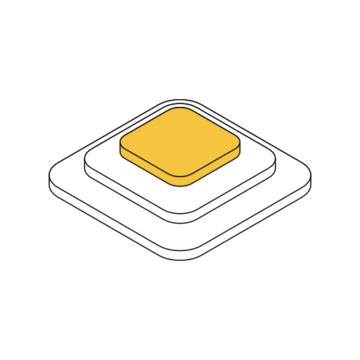
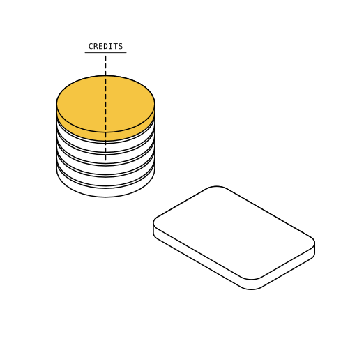
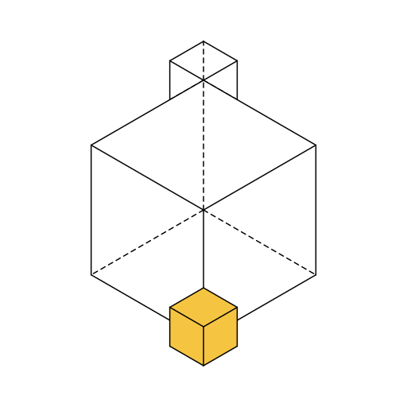

# isofig compiler

isofig makes isometric figures from a short description. A small model writes
the scene as a few lines in the isofig language, constrained by a grammar
(`isofig.lark`) so it can only produce lines that parse. This repo is the other
half: a deterministic compiler that turns those lines into an svg.

The compiler does the parts a model is bad at:

- projection: true 30 degree isometric, or a flatter 2:1 view per style
- depth order: an exact back to front sort for axis aligned solids
- settle: solids placed a hair into each other get slid clear
- hidden lines: clipped, or drawn dashed when asked
- arrow routing between named solids
- styles: one figure, several looks, nothing in the figure is a colour
- motion: entrances, floats, flows and hovers as css keyframes, or a still frame at any time
- icons: about 3900 Material Symbols glyphs, looked up by name
- lint: overlaps and arrows through solids, reported with how deep they go

TypeScript, no runtime dependencies. Node 24 or newer runs the `.ts` files
directly, there is no build step.

Try it at [isofig.app](https://isofig.app). The write up is at
[gmintu.dev/projects/isofig](https://gmintu.dev/projects/isofig).

## run it

    git clone https://github.com/Gmin2/isofig-compiler
    cd isofig-compiler
    node src/cli.ts examples/rounded.fig -o rounded.svg

`npm install` is only needed for the typechecker. `npm test` runs the checks.

As a library:

```ts
import { compile, styleNamed } from "./src/index.ts";

const r = compile(`slab base 4 4 0.3 at 0 0 0
box top 2 2 1 on=base accent`, { style: styleNamed("mono") });

if (r.ok) console.log(r.figure.svg, r.figure.issues);
else console.error(r.error.line, r.error.message);
```

`compile` never throws for a bad figure. Pass `lenient: true` to draw what can
be drawn and get a list of what was left out, `at: seconds` for one still frame
of a moving figure. `frames()` gives every frame for a gif or video, and
`rankSamples()` / `pickBest()` pick the cleanest of several model samples for
the same prompt.

## the language

One statement per line: a keyword, a name, some numbers, then options. Sizes
and positions are scene units, the compiler picks the scale. Names let later
lines point at earlier ones.

Three plates stacked with `on=`, rounded with `r=`, the top one marked as the
point with `accent` ([examples/rounded.fig](examples/rounded.fig)):

    slab base 6 6 0.35 r=0.9 at 0 0 0
    slab mid 4.4 4.4 0.35 r=0.7 on=base gap=0.25
    slab top 2.8 2.8 0.35 r=0.5 on=mid gap=0.25 accent



A `stack` repeats a layer, `beside=` places next to something, `tag` labels it
([examples/coins.fig](examples/coins.fig)):

    stack coins 2 2 0.22 r=1 at 0 0 0 n=6 gap=0.06 accent=5
    box card 3 2 0.25 r=0.3 beside=coins +x gap=1.2
    tag coins "CREDITS"



Edges behind a solid are removed. `hidden=dashed` draws them as dashes instead
([examples/hidden.fig](examples/hidden.fig)):

    box back 1.2 1.2 1.2 at -2.6 -2.6 1.4 hidden=dashed
    box big 4 4 4 at 0 0 0 hidden=dashed
    box front 1.2 1.2 1.2 at 5 5 1.4 accent



Beyond these there are trays, grids, cylinders, extruded shapes, block letters,
icons, arrows, links, holes, patterns, and a set of motion lines (`enter`,
`float`, `flow`, `hover` and so on). The full reference is in
[docs/dsl.md](docs/dsl.md).

## layout

    src/parse.ts      lines to statements
    src/scene.ts      statements to solids: placement, names, arrow routing
    src/settle.ts     slide shallow overlaps apart
    src/iso.ts        projection
    src/visible.ts    depth order and hidden edges
    src/svg.ts        drawing
    src/motion.ts     keyframes, and still frames from them
    src/style.ts      the styles
    src/icons.ts      glyph lookup over src/glyphs.generated.ts
    src/lint.ts       what is wrong with a figure that still compiles
    src/live.ts       a figure that follows the pointer, for the browser
    src/index.ts      the library api
    isofig.lark       the grammar the model is constrained by
    tools/            rebuilding the glyph catalogue, frame export

## license

MIT, see [LICENSE](LICENSE).

The icons in `src/glyphs.generated.ts` are Google Material Symbols, used
unchanged under the Apache License 2.0. Their licence and where they came from
are in [icons/](icons/).
